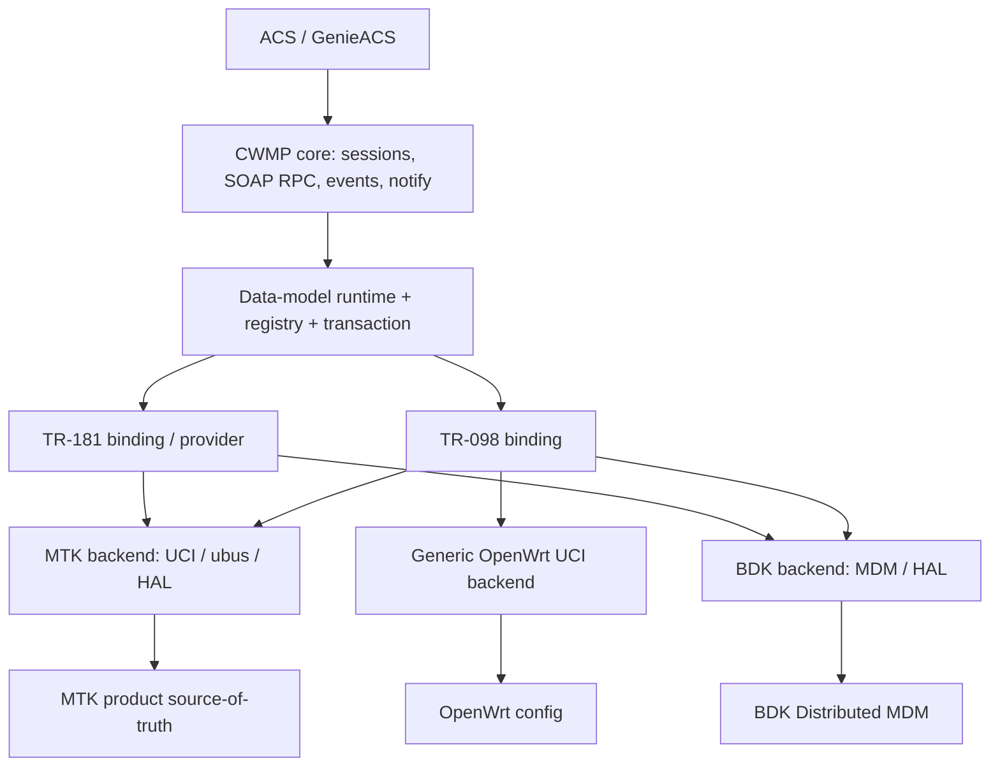

# ICWMP Multi-SDK — Review hiện trạng và kế hoạch tối ưu

**Ngày tổng hợp:** 2026-10-11  
**Repository:** `https://github.com/tunguyenvanbn94/icwmpMultiSdk`  
**Baseline yêu cầu:** `dev_181`  
**Mục đích:** đánh giá mức hỗ trợ MTK/Airoha, Broadcom BDK và UCI/OpenWrt; rà lại thiết kế HLD/LLD, mức bằng chứng, rủi ro và trình tự triển khai an toàn trên branch `dev_gpt`.

> **Quy tắc đọc báo cáo:** `REPORTED` = kết quả đã được ghi trong nhật ký của repository; `REVIEW` = nhận định kỹ thuật dựa trên các thông tin đã xem; `VERIFY` = cần checkout nguồn tại SHA thật và kiểm tra lại trước khi thay đổi code. Không coi build PASS là board PASS, hoặc board smoke test là full TR-181 compliance.
>
> **Giới hạn lần tổng hợp này:** môi trường tạo báo cáo không thể `git fetch/clone` (DNS GitHub không hoạt động), nên không có SHA HEAD mới được Git xác nhận tại thời điểm tạo, không có build/test mới trên source. Các con số được trích từ `docs/issue/implementation-status.json` (`updated_at: 2026-10-10 18:02`) và kết quả review trước đó. Báo cáo không khẳng định mọi chi tiết code còn nguyên tại HEAD mới nhất.

## 1. Executive summary

Dự án đã chuyển từ giai đoạn migration của MTK TR-098 sang **nền tảng dual-model, multi-SDK đã có board evidence**. Hướng kiến trúc một protocol core C, build riêng theo SDK, model TR-098/TR-181 độc lập về khái niệm và kết nối vào nguồn dữ liệu gốc của từng sản phẩm vẫn hợp lý. Không đề xuất viết lại tổng thể. Đề xuất chuyển đầu tư từ port số lượng lớn sang **contract stabilization, runtime correctness, compliance có phạm vi, và release engineering**.

### 1.1. Bằng chứng/khả năng đã ghi nhận

| Hạng mục | Kết quả ghi nhận | Giới hạn diễn giải |
|---|---|---|
| MTK/Airoha TR-098 | Inventory 783/783 chuyển sang C; build tắt `dm-script-compat`, parity board PASS | Chưa đồng nghĩa tất cả setter/object lifecycle đều stress-test mọi trường hợp |
| MTK/Airoha TR-181 | Branch `dev_181` có TR-181 mapping và native C; BBF check trên board đạt 734 tham số công bố; thực nghiệm GenieACS session | 734 là phạm vi agent công bố và kiểm, không phải toàn bộ TR-181 specification |
| MTK hiệu năng | Báo cáo GPV toàn cây native C xấp xỉ 1 giây, trước đó shell khoảng 23 giây | Phụ thuộc image, số tham số và điều kiện đo |
| MTK runtime | Theo nhật ký: GPV/GPN/SPV, rollback, notify, Connection Request, board parity, build và host tests đã có bằng chứng | Soak đầy đủ với tải ACS và mọi RPC vẫn cần bổ sung |
| Broadcom BDK | Image MO77300EB chạy board; báo cáo `bdk_apply_check.sh` 87 PASS/0 FAIL ở các ca WAN/LAN/Wi-Fi/NAT đã chọn; đã hoạt động với TR-098/TR-181 | Không suy diễn thành full BBF compliance hoặc parity tất cả object; WAN MTU MDM persisted nhưng runtime apply còn khác biệt |
| OpenWrt UCI generic | Có cấu trúc backend tham chiếu `sdk/uci` | Chưa có bằng chứng board/end-to-end tương đương MTK và BDK |
| Host & release | Có `tests/host/run.sh all`, công cụ static/cross-gcc, `apply.py` checksum/backup/rollback, `export.py --sdk` | Cần chạy lại đúng SHA/image khi freeze `dev_gpt` |

**Nguồn:**
- `https://raw.githubusercontent.com/tunguyenvanbn94/icwmpMultiSdk/dev_181/docs/issue/implementation-status.json` (`updated_at` 2026-10-10 18:02), mục `current`, `validation` và `next`.
- Nhật ký được tài liệu dẫn chiếu: `docs/issue/analysis.md`, chủ yếu các mục §63–§95.
- `docs/issue/tr181_mapping.tsv`, kiểm chuẩn T7 (xem trạng thái code tại SHA base thực tế).
- Các tài liệu handover trước: `icwmp_architecture_guide.md`, `icwmp_progress_matrix.md` (snapshot 2026-10-06).

## 2. Kiến trúc hiện có và đánh giá



*Sơ đồ logic.* Nó mô tả các thành phần và đường giao tiếp, **không** khẳng định tất cả interface cross-model đã được trừu tượng hóa hoàn toàn trong code.

### 2.1. Quyết định nên giữ

1. **Một CWMP protocol core C.** Không nhân đôi session, SOAP, retry, fault và event theo vendor SDK.
2. **Một source, SDK backend chọn lúc build.** Không cần plugin SDK chạy động trong firmware. Export/cắt bỏ SDK ngoài scope là cách đúng để kiểm soát footprint và dependency.
3. **Mỗi model là một dimension riêng với SDK.** Một board có thể hỗ trợ hai model; model không phải là định danh SDK.
4. **Registry và path ownership.** Định tuyến native/module theo claim thay vì if/else theo prefix rải rác; giữ khả năng phát hiện conflict.
5. **Tận dụng native MDM của BDK.** Service API chung chỉ nên xuất hiện cho semantics cần chia sẻ; không ép native TR-181 BDK qua layer giả gây double-mapping.
6. **Giữ ABI/package legacy đến release gate.** Không đổi SONAME chỉ để đồng bộ tên source khi thiết bị và các sản phẩm liên quan chưa sẵn sàng.

### 2.2. Rủi ro/điểm cần xác minh trước khi refactor

| ID | Quan sát từ review trước | Rủi ro | Đề xuất | Xác thực bắt buộc |
|---|---|---|---|---|
| ARC-01 | Model resolver đã có `dm_entry_load_model()`/latch nhưng luồng init vẫn liên quan `dm_platform_select_root()` và có thông tin fallback TR-098 | SDK vẫn quyết định một phần root; config sai có thể bị che | Resolver tập trung: verify compiled capability, fail-fast, latch bất biến trong phiên | Đọc `dmentry.c`, app config, host test và board switch giữa phiên tại HEAD |
| ARC-02 | TR-098 và TR-181 MTK tái dùng getter/setter nhưng nhiều binding còn sống trong nhánh tên `dm098/` | Model và backend semantic pha trộn, khó bảo trì | Tách dần theo domain, tránh big-bang rewrite | Mapping TR181/DMOBJ và ABI behavior |
| ARC-03 | Shared `tr098/managementserver.c` từng chứa `#ifdef DM_PLATFORM_BDK` | Common module phụ thuộc SDK | Service/hook ManagementServer theo vertical slice | Source HEAD hiện tại còn hay đã sửa |
| ARC-04 | Registry phát hiện claim overlap nhưng runtime không fail; BDK có thêm routing table riêng | Ownership divergence giữa model và proxy | CI gate conflict=0; thống nhất descriptor khi có thể | `dm_registry.c`, `dmproxy_bdk.c`, test claims |
| ARC-05 | BDK production flags từng chứa `-DBDK_SAMPLE_OBJECT` và `-g` | Sample/debug lọt production | Tách dev/debug config khỏi production | Source `sdk/bdk/sdk.mk` tại HEAD |
| ARC-06 | Transaction VALUECHECK→VALUESET→COMMIT có rollback từng store | Không đảm bảo atomic side-effects đa store | Fault injection & staged side effects, explicit journal khi có yêu cầu | Board multi-param SPV + HAL fault + restart cases |
| ARC-07 | MTK chứa operator `X_AIS_*` và prefix `X_HNI_*` trong backend | Backend bị product coupling | Product profile/extension modules; giữ ACS parity | Product inventory + path claims |
| ARC-08 | BDK có sai khác tên/type/access/status với chuẩn BBF; WAN MTU có report MDM ghi mà runtime chưa đổi | ACS có thể thấy trạng thái khác runtime | Triage whitelist vendor/version; test end-to-end applied behavior | BBF diff, MDM snapshots, network interface after write |

**Lưu ý:** Những dòng ARC-01/03/04/05 là `VERIFY` đối với HEAD mới; **không** thay code theo phỏng đoán khi chưa kiểm tra lại.

## 3. Tiêu chuẩn hoàn thành cho từng SDK × model

| Gate | Nội dung | Yêu cầu tối thiểu |
|---|---|---|
| G0 SOURCE | HEAD SHA, clean worktree, `dev_gpt` fork từ `dev_181` | `git merge-base --is-ancestor <base-sha> HEAD` |
| G1 STATIC | C sanity, automake conditions, no overlap, no unintended SDK references | 0 lỗi nghiêm trọng; conflict count = 0 |
| G2 HOST | Host CWMP core + registry/transaction/model tests | 100% selected suites PASS trên chính SHA |
| G3 BUILD | Build/link per SDK (MTK, BDK, UCI nếu support) | image/symbol/payload có checksum; product profile khớp |
| G4 BOARD | Boot/Inform, GPV/GPN/SPV, Add/Delete, notify/CR, persisted config | Có logs, device/image ID, ACS captures, so sánh source-of-truth |
| G5 MODEL | Chuyển model, kiểm source-of-truth và PATH isolation, zero stale state | Không rò `Device.*` vào TR-098 session và ngược lại |
| G6 SOAK | 24 giờ với phiên ACS thực, lỗi/timeout, VmRSS/fd/thread, restart | Chỉ đạt nếu đủ session tải và data có thể audit |
| G7 RELEASE | manifest/sha256, reproducible export, smoke kiểm install/rollback | Bản giao tái lập; tag/commit/release notes rõ ràng |

**Evidence states:** `STATIC_PASS`, `HOST_PASS`, `SDK_BUILD_PASS`, `BOARD_PASS`, `SOAK_PASS`, `NOT_RUN`, `KNOWN_LIMITATION`. Không được gộp thành một `PASS` chung.

## 4. Phase plan cho `dev_gpt`

### PH-G0 — Baseline & handover

**Mục tiêu:** branch thật từ `origin/dev_181`, lưu `base SHA`, báo cáo, matrix, constraints và known gaps trong `gpt_dev_note`.
- Điều kiện bắt đầu: checkout source sạch; fetch thành công; xác minh branch chính xác.
- Đầu ra: gpt_dev_note/README.md, review.md, phase-plan.md, evidence.md, changelog.md.
- Gate: không đụng code runtime, không force-push, không thay tag/release của `dev_181`.
- Commit gợi ý: `[gpt-dev 0001] docs: capture dev_181 baseline and optimization plan`.

### PH-G1 — Static guard & CI preflight (bước code an toàn đầu tiên)

**Mục tiêu:** công cụ phát hiện bất thường về multi-SDK/model và những dấu hiệu sample/debug chưa tách production.
- Đầu ra: `gpt_dev_note/tools/check_multisdk_gates.py`, unit tests, báo cáo JSON/Markdown.
- Cảnh báo: BDK_SAMPLE_OBJECT, ifdef SDK trong shared module, việc lựa chọn root từ SDK, thiếu cấu trúc backend, thiếu host test, path-registry contract.
- Không sửa tự động code vendor; flags advisory mặc định, strict mode dành cho CI khi baseline đã được xử lý.
- Gate: unit test PASS; chạy trên checkout thực và lưu kết quả; zero false positives cho các cảnh báo quan trọng.
- Commit gợi ý: `[gpt-dev 0002] test: add multi-SDK architecture preflight guard`.

### PH-G2 — Model/profile contract

**Mục tiêu:** active model duy nhất cho app/lib, compile-capabilities rõ, xử lý config sai có kiểm soát.
- Latch model khi init; fail fast nếu unsupported; không silently fallback; tránh switch trong session.
- Unit + host regression: TR-098-only/TR-181-only/dual, bad config, board inter-session switch, ubus GPV isolation.
- Không sửa BDK MDM behavior của product trong cùng commit.
- Gate: các tổ hợp profile hợp lệ/không hợp lệ được test; MTK và BDK smoke đủ.
- **Không thực hiện phase này chỉ dựa vào snapshot tài liệu:** phải xem source và chạy host tests.

### PH-G3 — Ownership & selective service refactor

**Mục tiêu:** registry là nguồn logic chung; tách compat/provider và ManagementServer nếu còn chưa tách; không ép BDK native MDM qua bridge thừa.
- Các bước nhỏ: ownership overlaps → BDK routing sync → ManagementServer service contract → smoke end-session.
- Gate: claim conflicts 0; GPV/GPN/SPV parity không đổi trên cả hai model.

### PH-G4 — Product/policy separation & BDK correctness

**Mục tiêu:** module extension theo product profile; triage sai khác BBF và hạn chế BDK runtime apply (WAN MTU, side effects).
- Mỗi thay đổi vendor behavior phải có owner/product signoff, chứng cứ board và rollback.

### PH-G5 — End-to-end ACS, soak, packaging

**Mục tiêu:** ma trận nghiệm thu MTK/BDK × TR-098/TR-181 × RPC; chạy stress/soak và chốt release.
- UCI backend chỉ được mark supported sau khi có build/runtime evidence riêng.

## 5. Ước lượng sơ bộ cho một kỹ sư

| Phase | Workdays ước lượng | Điều kiện |
|---|---:|---|
| PH-G0 docs/baseline | 1–2 | Có git + read-only repo |
| PH-G1 preflight | 1–3 | Có test Python |
| PH-G2 model resolver | 4–7 | Có cả host và 2 board |
| PH-G3 ownership/service | 6–10 | Không mở rộng scope data model |
| PH-G4 product/BDK correctness | 7–12 | Có SDK HAL access, product decisions |
| PH-G5 ACS/soak/release | 5–10 | ACS + board lab ổn định |
| **Tổng sequential** | **24–44 ngày công (~5–9 tuần)** | Không gồm phát triển toàn bộ profile TR-181 mới hoặc SDK mới |

Ước lượng **do review đề xuất**, không phải số liệu sprint thực tế; có thể tăng nếu lỗi chỉ xuất hiện trên board, vendor MDM giới hạn API hoặc công tác phối hợp sản phẩm trễ.

## 6. Quy tắc thay đổi và commit

1. Branch `dev_gpt` base trên `origin/dev_181` mới fetch; lưu chính xác `base SHA`; không rebase/force-push mà không được đồng ý.
2. Chỉ sửa phạm vi phase đã đăng ký; ưu tiên đổi contract nhỏ, PR/commit vừa đủ để revert độc lập.
3. Mỗi phase: mục tiêu → design delta → code → unit/host → cross build → board nếu cần → status → commit.
4. Nếu không có board, mô tả là `HOST_PASS/BOARD_NOT_RUN`; không tuyên bố phase có runtime complete.
5. Mọi điểm lùi và thay đổi kiến trúc ghi trong `gpt_dev_note/CHANGELOG.md` + ADR.
6. Runtime code PH-G2+ không được commit trước khi có source/compile/suite tương ứng; tuyệt đối không chỉnh firmware hay nạp board khi chưa có quyền access cụ thể.

## 7. Các file theo dõi dự kiến

```text
gpt_dev_note/
├── README.md
├── 01_BASELINE_REVIEW_2026-10-11.md
├── 02_ARCHITECTURE_DECISIONS.md
├── 03_PHASE_PLAN.md
├── 04_EXECUTION_LOG.md
├── 05_TEST_MATRIX.md
├── 06_BACKLOG.md
├── CHANGELOG.md
├── reports/
├── tools/check_multisdk_gates.py
└── tests/test_check_multisdk_gates.py
```

**Trạng thái tính đến thời điểm tạo:** báo cáo và code guard có thể chuẩn bị ngoại tuyến. **Chưa tạo được remote branch/commit trên GitHub** do không clone/fetch được repository từ môi trường hiện tại. Script kèm theo sẽ tạo branch từ `dev_181` thật khi chạy tại checkout với GitHub access và chỉ commit phase khi unit/guard checks hoàn tất.
